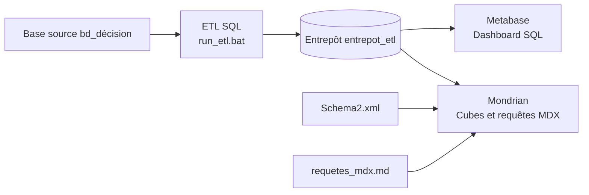

# Projet décisionnel e-commerce

Ce projet transforme les données d'une boutique e-commerce en un entrepôt de données pour analyser les ventes, les stocks, les avis, les retours, le trafic et les livraisons. Il comprend un ETL SQL, un tableau de bord Metabase et des cubes OLAP Mondrian.

## Architecture



Metabase sert au reporting SQL. Pour exécuter les requêtes MDX, il faut un moteur et un client compatibles Mondrian; Metabase ne charge pas directement `Schema2.xml`.

## Prérequis

- Windows et PowerShell.
- XAMPP avec MySQL/MariaDB installé.
- Java 21 ou plus récent, accessible dans `PATH` ou défini par `JAVA_HOME`.
- Une connexion locale à MySQL sur le port `3306`.
- Une connexion Internet au premier lancement de `install_metabase.bat` si le JAR Metabase n'est pas déjà présent.

## Démarrage rapide

Ouvre un terminal PowerShell dans le dossier du projet.

1. Démarre MySQL dans XAMPP, via le panneau de contrôle ou `mysql_start.bat` dans le dossier XAMPP.
2. Charge les données et construis l'entrepôt :

   ```powershell
   .\run_etl.bat
   ```

   Pour initialiser une base locale vide avec les données fictives fournies :

   ```powershell
   .\run_etl.bat demo
   ```

   **Attention :** `demo` charge des données fictives dans la base source. Ne l'utilise pas sur une base contenant des données réelles.

3. Installe Metabase hors du dossier du projet :

   ```powershell
   .\install_metabase.bat
   ```

   Le script réutilise le JAR présent dans le projet ou télécharge Metabase dans `%LOCALAPPDATA%\Metabase`. Le JAR et la base applicative Metabase ne sont pas destinés à GitHub.

4. Lance Metabase :

   ```powershell
   .\start_metabase.bat
   ```

5. Dans un navigateur, ouvre [http://127.0.0.1:3000](http://127.0.0.1:3000). Au premier lancement, suis l'assistant de configuration; ensuite, connecte-toi avec le compte Metabase déjà créé.

Garde le terminal de Metabase ouvert pendant l'utilisation. Après un nouveau clone du dépôt, lance simplement `install_metabase.bat`, puis `start_metabase.bat`.

## Connecter l'entrepôt à Metabase

Dans Metabase, ajoute une base de données de type MySQL ou MariaDB avec les paramètres suivants :

| Paramètre | Valeur locale |
| --- | --- |
| Hôte | `127.0.0.1` |
| Port | `3306` |
| Base | `entrepot_etl` |
| Utilisateur | `root` (configuration XAMPP locale) |
| Mot de passe | Celui configuré dans XAMPP; souvent vide en local |

Ne publie jamais un mot de passe ni une connexion de base de données sur GitHub. Pour un environnement partagé, utilise plutôt un compte SQL dédié en lecture seule et ne rends pas le serveur accessible depuis Internet.

## Créer le dashboard

Les requêtes SQL prêtes à utiliser et les visualisations recommandées sont dans [`metabase_dashboard.md`](metabase_dashboard.md).

Dans Metabase :

1. Crée une nouvelle question et choisis **SQL natif**.
2. Sélectionne la base `entrepot_etl`, colle une seule requête du guide et exécute-la.
3. Choisis une visualisation adaptée, puis enregistre la question.
4. Répète pour les indicateurs et graphiques souhaités, puis ajoute-les à un dashboard nommé **Analyse des ventes**.

Le jeu de démonstration est petit : les requêtes s'exécutent, mais les graphiques peuvent contenir peu de valeurs.

## Visualiser l'OLAP

Le schéma des cubes Mondrian est défini dans [`Schema2.xml`](Schema2.xml); les exemples de requêtes sont dans [`requetes_mdx.md`](requetes_mdx.md). Pour une analyse OLAP :

1. Configure une connexion Mondrian à la base `entrepot_etl`.
2. Charge `Schema2.xml` dans l'outil Mondrian utilisé.
3. Exécute une requête MDX de `requetes_mdx.md` dans un client OLAP compatible.

Les cubes couvrent notamment les ventes, le stock, le trafic web, la satisfaction, les retours, les paiements et les livraisons. Le cube de stock conserve des instantanés quotidiens à partir du premier chargement ETL.

## Arrêter les services

Pour arrêter Metabase proprement, sélectionne le terminal où `start_metabase.bat` tourne et appuie sur **Ctrl+C**. Pour arrêter le processus qui écoute sur le port `3000` depuis PowerShell :

```powershell
$listener = Get-NetTCPConnection -LocalPort 3000 -State Listen -ErrorAction SilentlyContinue |
    Select-Object -First 1

if ($listener) {
    Stop-Process -Id $listener.OwningProcess
}
```

Arrête MySQL depuis le panneau XAMPP ou ferme le terminal où `mysql_start.bat` fonctionne.

## Fichiers principaux

| Fichier | Rôle |
| --- | --- |
| `bd_decision.sql` | Création ou mise à niveau du schéma source |
| `donnees_demo.sql` | Jeu de données fictives pour un environnement local vide |
| `entrepot_etl.sql` | Schéma de l'entrepôt et procédure de chargement ETL |
| `run_etl.bat` | Lance le chargement SQL, avec option `demo` |
| `metabase_dashboard.md` | Requêtes SQL et suggestions de visualisations Metabase |
| `Schema2.xml` | Schéma des cubes Mondrian |
| `requetes_mdx.md` | Exemples de requêtes OLAP en MDX |
| `previsions_ventes.sql` | Estimation exploratoire de tendance des ventes |
| `modele_etoile.md` | Modèle de données, flux et limites des indicateurs |
| `install_metabase.bat` | Installation locale du JAR Metabase |
| `start_metabase.bat` | Démarrage de Metabase sur le port `3000` |

Les fichiers `.ktr` sont des prototypes ETL historiques; le chemin d'exécution prévu est le script SQL `run_etl.bat`.

## Limites et précautions

- Les données de démonstration sont fictives et ne représentent pas une activité réelle.
- Le taux d'abandon de panier ne peut pas être calculé avec les événements actuellement stockés.
- Les prévisions sont exploratoires et demandent davantage de mois de données pour être interprétées.
- Le stock historique commence au premier chargement de l'entrepôt.
- Metabase stocke sa configuration et ses comptes localement dans `%LOCALAPPDATA%\Metabase`; sauvegarde ce dossier si tu veux conserver l'instance. Ne le pousse pas dans le dépôt.
- Vérifie les fichiers avec `git status` avant publication afin d'éviter d'ajouter des données personnelles, mots de passe ou exports privés.